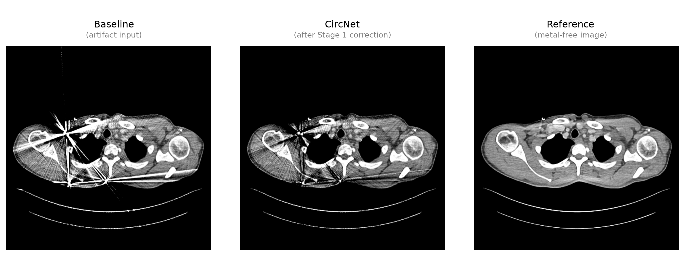

# CircNet

**CircNet** is a conservative polar-domain correction network for metal artifact reduction in reconstructed CT images. It is the first stage of the [PolMAR](https://github.com/barteklew/polmar) two-stage framework.

## Example result



*Left to right: artifact-corrupted input → CircNet output (Stage 1) → metal-free reference.*

## Overview

Metal implants induce characteristic streak and flare patterns that radiate outward from the metal region. CircNet exploits this radial geometry by processing each CT slice in a local polar coordinate system centred on each detected metal component.

Given an artifact-corrupted CT slice, CircNet:
1. Detects metal components via HU thresholding (default τ = 2500 HU).
2. For each component, constructs a polar grid of size N_θ × N_r.
3. Predicts a **non-negative** correction map c(θ, r) — ensuring only *subtraction* of bright streaks.
4. Applies the correction in Cartesian space, leaving the metal region unchanged by design.

This conservative formulation prevents hallucination of anatomical structures and provides a controlled prior for the subsequent [Refiner](https://github.com/barteklew/polmar) stage.

### Architecture

- **RadiusProjector** — projects each radial profile (N_r values) to a feature vector using a two-layer MLP with LayerNorm.
- **AngleUNet1D** — a 1-D U-Net along the angular axis with circular padding, preserving angular periodicity. Outputs correction magnitudes via Softplus (enforcing non-negativity).

```
Input:  [B, 2, N_θ, N_r]   (polar image + polar metal mask)
Output: [B, N_θ, N_r]      (non-negative correction map)
```

## Repository structure

```
circnet/
├── model.py          # CircNet architecture (ScalarCorrectionNet)
├── dataset.py        # PyTorch dataset — reads .raw CT slices
├── loss.py           # Training losses
├── loss_radial.py    # Radial loss variant
├── train.py          # Multi-GPU training (DDP)
├── train_radial.py   # Radial training variant
├── inference.py      # Single-GPU inference, outputs corrected .raw files
├── sanity_check.py   # Quick data/model sanity checks
└── slurm/            # SLURM sbatch scripts for Helios / PLGrid
    ├── run_train.sh
    ├── run_inference.sh
    ├── run_circnet_jitter.sh
    └── run_sanitycheck.sh
```

## Requirements

```
torch>=2.0
numpy
tqdm
scikit-image
opencv-python
```

Install:
```bash
pip install -r requirements.txt
```

## Data format

Input CT slices are stored as flat binary `.raw` files of shape `(H, W)` in `float32`, little-endian, C-order. File names follow the convention:

```
<prefix>_H<height>_W<width>.raw
```

## Training

```bash
python train.py \
  --data-dir  /path/to/raw/slices \
  --clean-dir /path/to/clean/slices \
  --output-dir /path/to/output \
  --polar-size 512x1024 \
  --radius-features 64 \
  --batch-size 8 \
  --epochs 100
```

Multi-GPU (DDP):
```bash
torchrun --nproc_per_node=4 train.py [same args]
```

See `slurm/run_train.sh` for a ready-made SLURM script for PLGrid/Helios.

## Inference

```bash
python inference.py \
  --model-path /path/to/best_model.pth \
  --input-dir  /path/to/artifact/slices \
  --output-dir /path/to/corrected \
  --polar-size 512x1024 \
  --radius-features 64 \
  --metal-hu 2500
```

## License

© 2026 Bartosz Lewandowski. Free for non-commercial use (research, academic, personal).
Commercial use requires a written license — contact **barteklew123@gmail.com**.
See [LICENSE](LICENSE) for full terms.

## Citation

If you use CircNet in your work, please cite the master's thesis:

```bibtex
@mastersthesis{lewandowski2026,
  title  = {Metal artifact reduction in computed tomography images},
  author = {Lewandowski, Bartosz},
  school = {Wrocław University of Science and Technology,
            Faculty of Information and Communication Technology},
  year   = {2026},
  month  = {7},
  type   = {Master's thesis}
}
```
